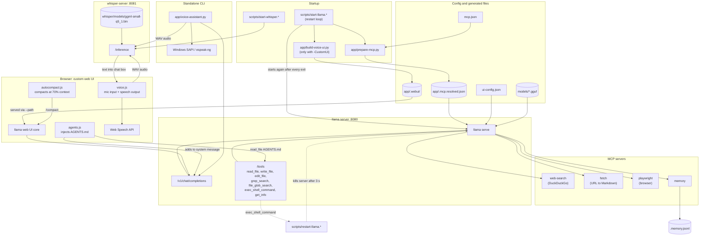

# Architecture: Local AI — Local LLM Chat with Voice

A self-hosted, offline-capable AI chat assistant powered by **llama.cpp** with an optional voice interface using **whisper.cpp** for speech-to-text and browser speech synthesis for text-to-speech.

---

### Folder Structure

```
├── AGENTS.md                     ← Workspace instructions (read before every answer)
├── README.md                     ← Documentation & usage guide
├── mcp.json                      ← Active MCP servers config (portable template)
├── mcp.json.bak                  ← Backup of unused MCP server configs
├── ui-config.json                ← Web UI settings + system message
├── requirements.txt              ← Python deps for app/ scripts
├── scripts/
│   ├── start-llama.ps1           ← Windows: start llama.cpp server (with auto-restart)
│   ├── start-llama.sh            ← Linux: start llama.cpp server
│   ├── restart-llama.ps1         ← Windows: model-initiated server restart
│   ├── restart-llama.sh          ← Linux: model-initiated server restart
│   ├── start-whisper.ps1         ← Windows: start whisper-server (port 8081)
│   └── start-whisper.sh          ← Linux: start whisper-server
├── app/
│   ├── build-voice-ui.py         ← Builds custom UI: copies llama UI + injects voice scripts
│   ├── prepare-mcp.py            ← Resolves mcp.json → .mcp.resolved.json (env vars, paths)
│   ├── voice-assistant.py        ← Standalone CLI voice assistant (mic → whisper → chat → speech)
│   ├── voice-ui/
│   │   ├── voice.js              ← Voice input + TTS injected into web UI
│   │   ├── agents.js             ← Auto-injects AGENTS.md into every request
│   │   └── autocompact.js        ← Auto-compacts context when approaching token limit
│   ├── .webui/                   ← [GENERATED] custom web UI (git-ignored)
│   └── .mcp.resolved.json        ← [GENERATED] resolved MCP config (git-ignored)
├── models/
│   ├── Qwen3.8-35B-A3B-Q4_K_M.gguf  ← The actual LLM model (~20GB)
│   └── README.md                 ← Instructions for model files
├── whisper/
│   ├── whisper-bin-x64.zip       ← Windows whisper-server binary (git-ignored)
│   ├── bin/                      ← [GENERATED] Windows build output
│   ├── models/
│   │   └── ggml-small-q5_1.bin   ← Whisper small model (speech recognition)
│   └── build/                    ← [GENERATED] Linux build output
├── .prompt-logs/                 ← [GENERATED] Conversation logs (git-ignored)
└── .memory.jsonl                 ← [GENERATED] Persistent knowledge graph (git-ignored)
```

---

### Component Explanations

| Component | Purpose |
|---|---|
| **llama.cpp (`llama serve`)** | The core LLM inference engine (port 8080). Loads the `.gguf` model, serves an HTTP API, runs MCP servers, and renders a web UI. |
| **whisper-server (port 8081)** | Speech-to-text engine using `ggml-small-q5_1.bin`. Accepts WAV audio → returns transcribed text. |
| **mcp.json** | Portable server manifest. Defines 4 MCP servers: `web-search` (DuckDuckGo), `fetch` (URL→Markdown), `playwright` (browser automation), `memory` (persistent knowledge graph). |
| **prepare-mcp.py** | Reads `mcp.json`, replaces `${ROOT}`, `${HOME}`, `$VAR` placeholders with real values, wraps Windows `npx` as `cmd /c npx`, outputs `.mcp.resolved.json`. |
| **build-voice-ui.py** | Starts a temporary llama server, downloads its built-in UI via HTTP, patches JavaScript (fix reasoning UI, expose compact API), injects `voice.js`/`agents.js`/`autocompact.js` scripts, re-caches with new SW revision. |
| **voice-assistant.py** | Standalone CLI voice bot: records mic → sends to whisper-server → streams response from llama → speaks aloud (Windows SAPI / Linux espeak). |
| **voice.js** | Browser voice input: detects speech via RMS threshold, sends WAV to whisper-server, injects text into chat box. Also taps streaming responses and reads them aloud via Web Speech API. |
| **agents.js** | Intercepts every chat request, fetches `AGENTS.md` via the tools API from the conversation's working directory, and prepends it to the system message. |
| **autocompact.js** | Monitors token usage in streaming replies; when >70% of context is used, calls the UI's compact (summarize old messages) automatically. |
| **ui-config.json** | Sets system message ("read AGENTS.md first, use tools"), enables tool call visibility, reasoning display, etc. |

---

### Mermaid Flowchart



---

### Key Design Decisions

1. **Portable `mcp.json`**: Uses `${ROOT}`, `${HOME}`, `$VAR` so it works on both Windows/Linux without hardcoded paths. `prepare-mcp.py` resolves them at runtime.

2. **Custom UI via copy-patch**: Instead of modifying upstream llama.cpp UI, `build-voice-ui.py` downloads it fresh each start (following upstream updates), patches the JS bundle, and injects voice scripts.

3. **Auto-AGENTS.md**: `agents.js` fetches `AGENTS.md` via the tools API for the *current working directory* of the conversation, making workspace context persistent across sessions.

4. **Auto-compaction**: `autocompact.js` monitors real-time token usage during streaming replies and triggers the UI's built-in "/compact" summarization before the context overflows.

5. **Dual voice paths**: The web UI uses browser-native Speech Synthesis + Web Audio API (no deps), while the CLI standalone uses `win32com.client.SAPI` on Windows or `espeak-ng` on Linux.